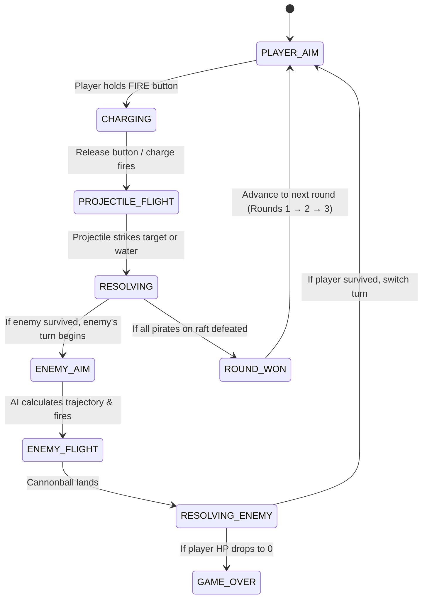

# CLAUDE.md - Developer & Agent Guide for Mini-Battle (Reef Rivals Edition)

Welcome to **Mini-Battle: Reef Rivals**! This guide is formatted specifically for Claude (Claude Code, Claude Desktop, or any AI coding assistant) to understand the codebase architecture, conventions, and extension workflows.

---

## 🌴 Project Overview

* **Concept**: A 3D tropical turn-based projectile battler built with **Three.js** and WebGL, inspired by [Reef Rivals (Treasure Tide)](https://github.com/mintdotgg/mint-playground/tree/main/experiences/reef-rivals) from `mintdotgg/mint-playground`.
* **Gameplay**: Player (a tube-riding hero on a raft) engages in turn-based artillery combat against an escalating pirate armada across a tropical reef lagoon over 3 rounds.
* **Core Mechanics**:
  - Drag-to-aim and elevation slider controls.
  - Power charging system with real-time 3D ballistic trajectory arc preview (incorporating gravity & crosswind).
  - Multi-ammo arsenal: Standard Coconuts, Explosive Pineapples, and Watermelon Cluster Bombs.
  - Dynamic cinematic chase camera tracking projectiles in flight.
  - Procedural Web Audio synthesizer (zero external MP3/WAV assets).
  - Low-poly procedural 3D graphics (zero external GLTF/GLB models to prevent missing asset errors).

---

## 📁 Repository Structure

```text
mini-battle/
├── index.html              # Main HTML entry: Canvas viewport, arcade HUD, modals
├── package.json            # ES module package definition & dev commands
├── server.js               # Zero-dependency Node.js HTTP static server
├── style.css               # (located in src/style.css) Arcade tropical UI overlay
├── CLAUDE.md               # Claude instruction & architecture documentation
├── README.md               # User & player documentation
└── src/
    ├── main.js             # Orchestrator & Game State Machine
    ├── scene.js            # Three.js world, lighting, dynamic wave water, environment
    ├── audio.js            # Web Audio API sound synthesizer
    ├── entities/
    │   ├── player.js       # Player raft, tube hero, swivel cannon, trajectory arc
    │   ├── enemy.js        # Pirate armada (Round 1, 2, 3), AI aiming & ballistics
    │   └── projectile.js   # Projectile physics, gravity, wind, split logic
    └── fx/
        └── particles.js    # Splash rings, explosion sparks, wood debris, muzzle smoke
```

---

## ⚡ Quickstart & Development Commands

### 1. Running the Game
```bash
# Start the local development server (port 3000)
npm start
# or
node server.js
```
Then navigate to: `http://localhost:3000`

### 2. Dependencies
* `three`: `^0.187.0` (installed in `node_modules/three`)
* Uses native ES modules with browser `<script type="importmap">` for zero-build fast iteration.

---

## 🎮 Game State Machine & Architecture

The game lifecycle in `src/main.js` transitions through the following states:



---

## 📐 Physics, Coordinates & Ballistic Rules

1. **Coordinate System**:
   - `+X` points toward the enemy raft (East). Player is at `X = -24`, Enemies are at `X = 22 to 27`.
   - `+Y` points upward (Sky). Water level base is `Y = 0`.
   - `+Z` / `-Z` represents the North/South crosswind axis.
2. **Gravity & Wind**:
   - Gravity constant: `18.0 m/s²`.
   - Trajectory calculation:
     $$\vec{v}_{t+\Delta t} = \vec{v}_t + \vec{g} \Delta t + 0.4 \cdot \vec{w}_{wind} \Delta t$$
     $$\vec{p}_{t+\Delta t} = \vec{p}_t + \vec{v}_{t+\Delta t} \Delta t$$
3. **Water Buoyancy**:
   - Synchronized by `world.getWaterHeightAt(x, z, time)`:
     ```javascript
     wave = Math.sin(x * 0.12 + time * 2.2) * 0.35 +
            Math.cos(z * 0.15 + time * 1.8) * 0.3 +
            Math.sin((x + z) * 0.08 + time * 1.4) * 0.2;
     ```
   - All rafts, projectiles, and splash rings sample this exact formula so visuals remain perfectly in sync.

---

## 🛠️ How to Extend the Game (Guidelines for Claude)

When modifying or adding features, follow these conventions:

### Adding a New Weapon
1. In `src/entities/projectile.js`:
   - Add new weapon type in `createMesh()` using Three.js geometries (e.g., `'banana_boomerang'`, `'kraken_ink'`).
   - Define custom damage, blast radius, and special update behaviors.
2. In `src/main.js`:
   - Add ammo entry to `this.ammo = { ... }`.
   - Add weapon button in `index.html` and bind click event.
3. In `src/audio.js`:
   - Add synthetic audio cues for launch, sizzle, or impact.

### Adding New Enemy Rounds (Round 4+)
1. In `src/entities/enemy.js`:
   - Extend `setupRound(roundNumber)`.
   - Build custom modular rafts (e.g., Floating Fortress, Ghost Skiff, Kraken Tentacle).
   - Tune AI accuracy spread in `calculateAIShot(playerPos, wind)`.
2. In `src/main.js`:
   - Increase `this.maxRounds` to accommodate new waves.

### Code Style Standards
- Keep 3D models procedural using standard Three.js primitives (`CylinderGeometry`, `BoxGeometry`, `SphereGeometry`, `DodecahedronGeometry`) with `MeshStandardMaterial` (`roughness`, `flatShading: true`).
- Synthesize all sounds via the Web Audio API in `src/audio.js` so no external audio assets are required.
- Do not introduce heavy build-step tools that break single-command execution.

